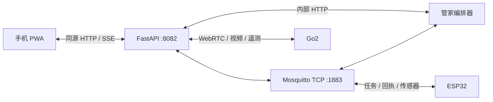

# SSM — Smart System Mesh

分布式多智能体 IoT 系统，连接 ESP32、云端管家 / 灯 / Go2 智能体与手机 PWA。设备通过 MQTT retained manifest/card/status 声明能力与在线状态；管理员将发现的设备加入固定空间 `main` 后，PWA 自动同步，无需手动订阅。

## 架构与使用



控制面统一走 MQTT，ESP32 任务走 MQTT，Go2 数据面走 HTTP/SSE。角色决策位于 `cloud/agents/{steward,lamp,go2}/`，共用 LangChain/LangGraph、文件检查点与动作账本。工具按序执行、等待真实结果；新用户目标会淘汰旧运行，结果未知时按原任务 ID 查询。

用户可聊天、控制设备、确认教导或启动空间活动。灯默认 `manual`，`reactive` 下结合传感器自主决策；Go2 自主模式为 `free_explore`。活动中的协作与游戏由各设备自己的 Graph 决策，用户再次介入结束活动。ESP32 硬件 tick 独立运行，当前没有离线自动控灯规则。

## 部署

需要 Python ≥3.13、uv、Mosquitto 和 `envsubst`；公网部署另行配置同源代理、HTTPS 与网络访问策略。PWA 使用 React 全局脚本，无构建步骤。

在项目根目录执行：

```bash
uv sync
cp -n cloud/.env.example cloud/.env
```

编辑 `cloud/.env`，配置以下项目；已有配置不要覆盖：

| 配置 | 用途 |
|---|---|
| `OPENAI_BASE_URL`、`OPENAI_API_KEY` | 兼容 OpenAI 的模型服务 |
| `TEXT_MODEL`、`VISION_MODEL` | 全系统文字与视觉模型，以服务实际支持为准 |
| `ORCHESTRATOR_MAX_TOKENS` | 管家输出额度；默认 `0`，沿用模型服务默认值；仅正整数主动限制，过小可能导致空响应 |
| `MQTT_BROKER_HOST/PORT`、`MQTT_API_*`、`MQTT_ORCHESTRATOR_*` | Broker 地址及云端专用账号 |
| `SSM_INTERNAL_SERVICE_TOKEN` | API、编排器共用的内部认证与默认 MQTT 签名来源 |
| `SSM_SESSION_SECRET` | 至少 32 字符，保持重启后的会话签名稳定 |
| `SSM_COOKIE_SECURE` | HTTPS 设 `true`，仅本机 HTTP 调试设 `false` |
| `GO2_EMAIL/PASSWORD/SERIAL`、可选 `GO2_REGION` | 使用 Go2 时自行加入 `.env`，region 默认 `cn` |

Broker 账号需在本机创建，密码与云端、边缘配置对应。首次使用 `mosquitto_passwd -c infra/broker/passwd ssm_api`，再用不带 `-c` 的命令追加 `ssm_orchestrator` 和 `esp32_desk`；已有密码文件禁止用 `-c` 覆盖。公网部署按 [acl.example](infra/broker/acl.example) 创建本机 `infra/broker/acl`，并在 [Broker 模板](infra/broker/mosquitto.conf.tmpl) 中启用 `acl_file`。当前模板仅 TCP 1883，无 TLS、无 WebSocket 9001，应限制访问来源。

前台服务分别在独立终端或 tmux 窗口运行：

```bash
make broker
make api
make orchestrator
make pwa
```

需要后台运行时使用相应 `-bg` 目标，例如 `make api-bg`；重复执行会重启对应服务。`make api` 监视 `cloud/` Python 和 `cloud/.env`，`make api-bg` 无热重载；编排器配置修改后须单独重启。`make stop` 强制停止 Makefile 管理的进程，不能作为备份前正常停服的替代。

API/PWA 仅监听 `127.0.0.1:8082/8081`。同源代理应将 `/api` 转发到 API、其余路径转发到 PWA；仓库不负责安装或生成 nginx 配置。现有 Cloudflare 部署使用 `cloudflared tunnel run ssm`，对应 `make tunnel-bg`；`make tunnel-url` 只打印配置地址，不创建或验证隧道。

Go2 人脸身份依赖腾讯云 IAI 3.0：填写示例配置中的腾讯云凭据、region 与已有人员组 ID。管理员经 `/api/people` 登记照片，本地只存人员元数据。写入由 `SPACE_FACE_ENROLLMENT_ENABLED` 控制，兼容旧 `GO2_FACE_ENROLLMENT_ENABLED`，缺省开启；无有效服务凭据时不可写。

## ESP32

引脚、能力与探测以 [edge/config.py](edge/config.py) 为准：灯环 GPIO25、光线 ADC GPIO34、声音 GPIO32；红外 GPIO19 已配置，接线记录为未接，以启动 `PRESENCE` 为准。灯与声音通过 `flag` 显式启用。只有智能体发布 manifest，传感器独立发布 state/event。

刷入兼容的 MicroPython，确认有 `umqtt.simple`。复制 `edge/local_config.example.py` 为 `edge/local_config.py`，填写 WiFi/MQTT；本机另装 mpremote 后上传：

```bash
cd edge
mpremote connect <端口> cp boot.py clock.py lamp_contract.py config.py local_config.py probe.py ism.py bsm.py \
  mqtt_client.py trigger_map.py agent_manifest.py main.py :
mpremote connect <端口> reset
```

串口检查校时、`[Probe]` 和 manifest 发布。灯只有 `OFF/ON/BLINKING`；点击闪烁默认持续，明确次数才有限闪烁。默认亮度与物理输出上限见 `config.py`，动作参数契约见 `edge/lamp_contract.py`。

## 运行数据与迁移

**Git 保存代码、测试、示例配置及协议；运行资产必须单独备份。** 下表是源码默认路径，环境变量覆盖时以实际路径为准。

| 路径 | 内容 |
|---|---|
| `cloud/data/{checkpoints,run_index,effects}/` | 共享 Graph 检查点、运行索引、动作账本 |
| `cloud/agents/data/training/` | 用户确认的教导 |
| `cloud/{esp32,go2,orchestrator}/data/` | 各设备任务、记忆、人格等 |
| `cloud/space/data/` | 活动、人员、用户目标代次 |
| `cloud/space/{space,device_codes}.json`、`cloud/space/audit.jsonl` | 空间成员、接入码、审计 |
| `cloud/.env`、`edge/local_config.py`、`infra/broker/passwd`、本机 ACL | 凭据及部署配置 |
| `logs/broker/mosquitto.db` | 当前 Broker 持久化库，**不能按普通日志清理** |

共享目录可由 `SSM_CHECKPOINT_DIR`、`SSM_RUN_INDEX_DIR`、`SSM_EFFECT_LEDGER_DIR`、`SSM_TRAINING_DIR` 覆盖；设备目录可由 `ESP32_DATA_DIR`、`GO2_DATA_DIR`、`ORCHESTRATOR_DATA_DIR` 覆盖。人员目录使用 `SPACE_DATA_DIR`，目标代次使用 `SSM_USER_GOALS_DIR`。

迁移前正常结束设备活动、停服并备份，Broker 应正常退出后再复制数据库；不要依赖强制结束进程保存内存状态。保留凭据、目录权限和稳定会话密钥，核对新服务器 IP、设备 Broker 地址、代理与 Tunnel。新旧服务避免同时控制设备；验证完成后再释放旧机。仓库外的 nginx、Tunnel、Codex 用户目录等也要单独迁移。历史任务、旧教导不得当作新动作重放。

`docs/`、`output/`、`.superpowers/` 是本地过程资料，不随 Git 发布。克隆仓库不会恢复这些文件或上述运行资产。

## 开发与排查

| 位置 | 职责 |
|---|---|
| `edge/` | MicroPython 驱动、状态机、MQTT 接线 |
| `cloud/agents/` | 角色 Graph 与共享运行/教导框架 |
| `cloud/api/`、`cloud/cards/` | 会话 API、SSE、MQTT 设备卡注册表 |
| `cloud/esp32/`、`cloud/go2/`、`cloud/orchestrator/` | 服务入口和执行适配 |
| `cloud/peers/`、`cloud/space/`、`cloud/personality/` | 协作、空间、人格 |
| `app/` | 无构建 PWA，直接编辑 JSX |
| `protocol/` | MQTT、Agent Card 与标识契约 |

```bash
make ps
make logs
make trace-task ID=<session_id>
make errors
uv run python -m pytest cloud edge -o 'python_files=test_*.py *_test.py *_checks.py' -q
git diff --check
```

`make trace` 实时查看 `ssm/#` MQTT 消息，断线自动重连；通过 python-dotenv 加载 `cloud/.env` 的 Broker 地址、端口和 API 账号，账号未配置时兼容回退到 `MQTT_USER/PASSWORD`。

测试必须使用临时目录与模拟设备，不覆盖本机运行资产。前端回归见 `scripts/check_*.cjs` 的依赖说明；模拟通过不代表真机或真实模型已验收。修改约束见 [AGENTS.md](AGENTS.md)，协议见 [topics.md](protocol/topics.md)、[agent-card.md](protocol/agent-card.md)，追踪说明见 [OBSERVABILITY.md](OBSERVABILITY.md)。
