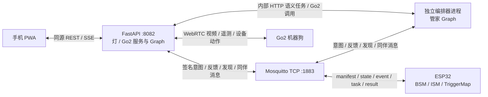

# SSM — 智能系统网格（Smart System Mesh）

分布式多智能体 IoT 系统：以 MQTT 为统一**控制总线**（发现、在线状态、能力声明 card），**数据面按设备本性选传输**（ESP32 走 MQTT、Go2 走 HTTP/SSE）。连接 ESP32 边缘设备、云端 AI 智能体（管家 / 灯 / Go2 机器狗）和手机 PWA。设备通过 retained manifest/card 被发现，能力由 A2A Agent Card 描述；管理员将发现的设备加入固定空间 `main` 后，PWA 自动同步其状态与能力。

本文说明当前代码与部署入口；历史计划及验收记录不代表当前测试结果。依赖以 [pyproject.toml](pyproject.toml) 和 `uv.lock` 为准，配置以 [cloud/.env.example](cloud/.env.example) 与 [edge/config.py](edge/config.py) 为准。

## 系统架构



**控制优先级**：用户指令优先于自主行为；灯通过让位窗口、Go2 通过运动租约与中断尊重用户介入。当前固件没有离线自动控灯规则。

云端有三个 LLM 智能体，模型决策分别位于 `cloud/agents/{steward,lamp,go2}/graph.py`：

- **编排器**（`cloud/orchestrator/`，独立进程）：订阅用户意图，经管家 Graph 统筹全局，MQTT 派发到 ESP32、HTTP 委托到 Go2。
- **ESP32 桌面智能体**（`cloud/esp32/service.py`）：灯 Graph 处理对话与传感器触发的自主决策。
- **Go2 机器狗智能体**（`cloud/go2/`）：Go2 Graph 处理对话与自主决策；设备层负责导航、视觉与 WebRTC。

三角色统一以 System 消息承载职责和表达规则，以 User 消息保留用户原话，以原生 Tool 消息提供真实结果。普通聊天的最终回复直接来自决策最后一轮；独立动作回执和自主行动按需生成回复。必要补充由 LangGraph interrupt 暂停与恢复，完成的动作不会因用户补充而重新派发。

用户可通过自然语言教导场景、动作与参数，例如保存当前灯光用于阅读。场景由模型语义理解，调用时按教导 ID 和版本读取保存参数，支持本次局部覆盖与长期追改。Go2 的普通人物出现教导在待命和自由探索下都可触发，无需身份识别；带主人条件的教导另行校验可信身份。状态图连线展示场景、动作和具体参数。

## ESP32 硬件与探测

| 硬件 | GPIO | 模式 |
|------|------|------|
| WS2812 灯环（数据线） | GPIO4 | 单总线 |
| 光线传感器 | GPIO34 | 模拟（ADC1） |
| 声音传感器 | GPIO15 | 数字，上升沿触发 |
| 红外传感器 | GPIO19 | 已配置，当前接线记录为未接；以启动探测结果为准 |

`edge/probe.py` 按 `UNIT_CONFIGS` 执行探测：光线使用 ADC，红外使用数字输入；声音传感器为开漏输出，当前与灯一样使用 `flag` 显式启用。缺席传感器不发 `state/event`；只有灯发布智能体 manifest，传感器不生成设备卡。灯环为 16 颗 WS2812，物理输出单通道上限见 `WS2812_MAX_VAL`。

## 各组件说明

### ESP32 边缘端（`edge/`）

| 文件 | 职责 |
|------|------|
| `boot.py` | 启动时连接 WiFi |
| `config.py` | 引脚、MQTT 地址、时序常量、**UNIT_CONFIGS**（unit 注册表） |
| `local_config.py` | 本机 WiFi/MQTT 密钥（从 example 复制，git 忽略） |
| `probe.py` | 按注册表执行 ADC / 数字探测或读取显式 flag |
| `bsm.py` | 行为状态机——GPIO/PWM/ADC 驱动，事件回调 |
| `ism.py` | 接口状态机——仅处理状态转换，不涉及硬件 |
| `lamp_contract.py` | 当前灯固件参数和能力契约，与云端工具及 Card 共用 |
| `trigger_map.py` | BSM ↔ ISM ↔ MQTT 接线（唯一耦合点） |
| `agent_manifest.py` | 为已探测到的智能体发布 retained manifest，并清理旧传感器 manifest |
| `mqtt_client.py` | MQTT 封装，支持自动重连和 LWT |
| `clock.py` | NTP 校时、Unix 时间换算与重试 |
| `main.py` | 主循环入口 |

传感器独立发布 `state/event`，供云端灯 Graph 使用。当前固件只订阅灯任务主题；云端离线时硬件 tick 继续运行，不会根据传感器新增自动控灯动作。

### 云端服务（`cloud/`）

环境变量统一存放在 `cloud/.env`（见 `cloud/.env.example`），模型构造统一在 `cloud/agents/common/models.py`。使用兼容 OpenAI 的模型服务，提供方与模型名由部署配置决定：

| 配置 | 用途 |
|------|------|
| `OPENAI_BASE_URL`、`OPENAI_API_KEY` | 三角色文字模型与 Go2 视觉模型共用的服务地址和凭据 |
| `MODEL_LIST` | 管家文字模型候选，逗号分隔，按顺序 fallback；缺省回退到 `MODEL` / `deepseek-chat` |
| `DEVICE_TEXT_MODEL` | 灯与 Go2 共用的文字模型，代码默认 `deepseek-v4-flash-0731` |
| `GO2_VISION_MODEL` | Go2 视觉语言模型，代码默认 `qwen` |

Go2 本地人物/人脸检测使用 OpenCV HOG/Haar；场景理解、目标搜索和视觉导航结合视觉语言模型、RGB/LiDAR 与里程计反馈。当前依赖不包含 YOLO/ultralytics。

Go2 人脸身份使用腾讯云 IAI 3.0 人员库。部署时在 `cloud/.env` 配置
`TENCENTCLOUD_SECRET_ID`、`TENCENTCLOUD_SECRET_KEY`、`TENCENTCLOUD_REGION` 与
`TENCENT_FACE_GROUP_ID`；人员库必须已存在且 `FaceModelVersion=3.0`。识别由
`GO2_FACE_RECOGNITION_ENABLED` 控制。管理员经 `/api/people` 从手机照片登记或删除人员；写入开关为
`SPACE_FACE_ENROLLMENT_ENABLED`，兼容回退到 `GO2_FACE_ENROLLMENT_ENABLED`，代码缺省为 `true`。
未配置服务凭据时人员库不可写；需要禁用写入时显式设为 `false`。

身份匹配固定以 80 分为阈值：达到 80 分且 PersonId 对应本地已登记人员时立即确认；
低于 80 分、无匹配或本地没有该人员时返回 `status=unknown`、`name=陌生人`、`role=stranger`。
不再配置接受分/候选分，也不等待两次匹配。自动识别先要求本地检测到恰好一张人脸，
且原图脸框短边至少 80 像素；主动请求识别时，无人脸、图像不合格和服务失败仍分别报告错误，不能据此判断陌生人。

Go2 视频保留接收帧原尺寸，JPEG 质量为 90，编码上限 10 帧/秒；采集持续读取视频流，
不积压待处理帧。后台检测约每秒取一次新帧：人体检测等比缩至最多 320 像素宽，
人脸检测等比缩至最多 640 像素宽，身份识别从原尺寸图裁脸。
检测结果沿用真实采集时间和源帧编号；重复帧不产生新观察，超过 5 秒的帧不能用于当前感知。

身份结果最多有效 5 秒，`GO2_FACE_RECHECK_S` 取 1~5 秒（旧的更大值按 5 秒处理）。
人脸消失、变为多人、位置明显不连续或相机会话变化会撤销旧身份；连续单脸也须定期重新匹配，
脸框连续不等于身份已被重新验证。聊天与自主社交只读取新鲜身份投影，不从历史记忆推断当前主人。
腾讯云检查/搜索失败报告错误，保留识别开关，至少间隔 5 秒再尝试恢复；重连会重新检查。
人员出现教导可在最多 5 秒内等待新鲜身体遥测；用户接管、离开画面、事件过期或设备正被占用时丢弃等待，
不排队补发旧物理动作，实际动作仍走原教导版本、权限和完成回执校验。

本地只保存 `PersonId`、姓名、关系和人脸数量到
`cloud/space/data/people.json`（可用 `SPACE_DATA_DIR` 覆盖目录，旧 Go2 人员文件仅用于兼容读取），不在本地人员库保存原始照片或 embedding；照片会上传腾讯云用于登记。

#### API（`cloud/api/`，FastAPI，端口 8082）

| 接口 | 说明 |
|------|------|
| `POST /api/admin/session`、`POST /api/visitor/session` | 创建管理员会话与访客邀请兑换 |
| `GET /api/me`、`DELETE /api/session` | 当前会话与退出清理 |
| `GET  /api/devices` | 固定 `main` 空间设备；已配置的离线设备仍返回 |
| `GET  /api/devices/{unit_id}/agent` | **A2A Agent Card**：机器可读的能力描述（数据取自 `cloud/cards/`） |
| `POST /api/intents`、`POST /api/commands/{unit_id}` | 认证后的统一手机命令入口 |
| `GET /api/events` | 按会话过滤的反馈与设备状态 SSE |
| `POST /api/emergency-stop` | 管理员和体验者均可用的全局安全停止 |
| `/api/training`、`/api/training/proposals` | 管理员培养记录、修改草案与用户确认；设备页培养入口查看和追改 |
| `GET /api/devices/{unit_id}/training` | 可训练转换、教导定义和动作参数 |
| `/api/admin/*` | 固定空间和访客邀请管理 |
| `GET /api/activity/current`、`GET /api/activity/{activity_id}/events` | 当前活动、历史元数据与时间线 |
| `POST /api/activity/start`、`POST /api/activity/end` | 启动与结束空间活动，要求有效会话及 CSRF |
| `/api/people`、`/api/agents/{agent_id}/personality` | 管理员人员库、人格配置 |
| `GET/PUT /api/esp32/autonomy` | 灯自主模式；修改要求管理员身份及 CSRF |
| `/api/go2/*` | Go2 数据面；读接口检查会话/权限，写接口要求内部服务身份与可信执行上下文 |

`api/main.py` 同时承载一个 ESP32 MQTT 桥，订阅 `manifest/state/event/result` 并喂给 ESP32 桌面智能体。

#### 编排器（`cloud/orchestrator/`，独立进程）

订阅 `ssm/intent/+`，调用 `cloud/agents/steward/graph.py` 的 LangGraph 逐步任务图，每次观察真实结果后继续规划。三角色共用 `cloud/agents/common/` 的文件检查点、动作账本和事件投影。

| 文件 | 职责 |
|------|------|
| `main.py` | MQTT 事件循环：意图 → 逐步任务循环 |
| `../agents/steward/graph.py` | 逐轮规划、派发、核对结果并生成管家回复 |
| `tools.py` | MQTT/HTTP 派发与反馈辅助 |
| `shared_state.py` | 线程安全 MQTT 传感器/执行器快照与可信会话元数据 |
| `trusted_context.py` | 签名意图、同伴请求与会话清理校验 |
| `card.py` | 管家公开能力卡 |

> 设备能力卡注册表见 `cloud/cards/`（`registry.py` 订阅 card/manifest/status，是 A2A 单一真相）。

#### 决策、设备服务与共享能力

| 目录 | 职责 |
|------|------|
| `agents/` | 三角色的 Graph、提示词、人格、记忆和自主工作流；`common/training/` 提供统一教导 |
| `esp32/` | 灯服务、自主模式、传感器事实、动作校验、任务去重与 MQTT 回执 |
| `go2/` | HTTP 服务、WebRTC、视觉、导航、执行校验与自主事件调度；调度器调用 `agents/go2/workflows/` 的 Graph |
| `personality/` | 三角色共用的人格存储、版本校验和名称管理；具体人格在各自 `agents/*/personality/` |
| `peers/` | 同伴发现、签名消息、技能请求、协作权限、取消和互动游戏 |
| `space/` | 空间成员、执行身份、用户要求、活动时间线和人员库 |
| `observability/` | 结构化日志、任务关联事件与脱敏 |
| `storage/` | 带锁、原子化的 JSON 文件存储 |

空间成员配置保存在 `cloud/space/space.json`，设备能力与在线状态仍来自 MQTT retained 消息。当前没有文件型设备能力注册表；教导通过 `/api/training` 管理，旧 `/api/rules` 与 `/api/teachings` 已退役。详细文件说明见 [云端智能体目录与设备互通](docs/architecture/agent-directory-and-peer-messaging.md)。

#### 状态、教导与协作边界

- **灯**只有 `OFF`、`ON`、`BLINKING` 三个物理状态。默认 `manual`，显式开启 `reactive` 后才自主调光；用户命令使自主层让位 300 秒，同伴控灯使用独立的 60 秒让位窗口。普通“闪烁”按钮默认持续闪烁，指定次数时才有限闪烁。
- **Go2**使用 connection / activity / life / body 分层状态，`autonomy_mode=manual|free_explore` 是配置。自由探索启动后，“探索”持续覆盖观察、规划和轮次间等待，具体进展通过对话展示；互动接管时显示“互动”，结束且探索许可仍有效时恢复“探索”。MQTT `status` 表示云端 Go2 服务在线，实际 WebRTC 连接看 `state.connected`；在线不等于已连接或已站立。RPC `accepted` 也不等于完成；姿态、运动与停止依赖真实遥测确认，休息不自动趴下，唤醒不自动起立或恢复探索。
- **统一教导**从 Card 的转换与动作参数生成目录，管理员自然语言提出草案并确认，执行时重读指定教导 ID、版本及约束。单动作、多动作、事件教导与场景参数复用现有执行链；保存、执行器已加载和物理动作完成分别展示。人物出现教导可在待命和自由探索触发；带主人条件的教导必须使用可信身份观察。
- **空间活动**保存用户原话、设备实际加入模式、消息、观察、动作及回执。活动通过 API 或管家工具启动，为灯选择 `reactive`、Go2 选择 `free_explore`；用户再次介入会结束当前活动，切回活动持有设备的 `manual` 并记录停止结果。活动没有默认到期时间，重启恢复不重放历史动作。
- **同伴协作**区分定向消息与单技能调用。消息受签名、成员身份、期限和去重校验；发出邀请不表示对方接受或动作完成。`color_hunt` 由模型结合新鲜观察决定是否邀请、选色与找物，不按固定延时或预设剧情执行。需要决策依据时，工具校验 `decision_reason/evidence_refs`，时间线保存当时的来源与摘要。

互动游戏在 `cloud/peers/games/` 按游戏分文件管理：每个文件定义该游戏的规则、玩法、策略说明、可用条件与执行入口，统一注册表负责汇总。找颜色、猜拳攻灯和配送均声明双向邀请，发起方不决定角色：灯和狗任意一方都可以提议，另一方自主接受、拒绝或延后。只有双方同处有效活动、在线且没有正在执行或等待确认的任务时才可邀请和开局；Go2 在探索轮次之间无具体任务、无导航或运动时可参与，休息、手动控制、动作未确认或等待用户补充时不可开局。灯的常亮、熄灭或持续闪烁本身不等于云端任务忙碌，实际会话、教导和物理回执等待分别检查。

自主社交没有固定发送间隔、次数配额或同话题冷却；双方进入空闲段以及新观察可提供一次重新判断的机会，现有 Graph 结合人格 traits、当前环境、任务及近期互动决定邀请、交流或保持安静。空闲不代表愿意接受；同一空闲段不会按时间反复催发邀请，同一对设备的待处理邀请也会阻止交叉发起第二局。找颜色支持灯邀请狗和狗邀请灯两个执行方向；双方同意后仍由灯依据真实观察选色并确认物理回执、狗寻找并以停稳和视觉复核确认结果。

新增游戏时：

1. 在 `cloud/peers/games/<game_id>.py` 定义 `GAME = Game(...)`，参考 `color_hunt.py`。填写 `description`（玩法简介）、`rules`（规则与完成判据）、`strategy`（适合邀请/接受的情境），以及 `participants`（参与双方）、`available` 和异步 `execute`。`bidirectional=True` 允许双方互邀，`requires_idle=True` 在邀请和接受开局前核验真实任务占用；未指定时保持已有单向游戏兼容。
2. 在 `cloud/peers/games/registry.py` 导入该 `GAME` 并加入 `GAMES` 的汇总项。规则和策略随可玩列表及邀请上下文进入现有 Graph，无需逐个修改角色提示词。
3. 按需提供 `on_invitation`（灯收到游戏邀请的处理入口）及 `on_acceptance` 准备回调；问答和意愿由既有角色 Graph 生成，规则不复制到角色提示词，不把狗的邀请重写成灯的固定口吻。执行复用已有 Graph、设备工具与真实回执，保留原邀请 ID 去重及结果关联。补充该玩法的模拟回归，勿用现有运行资产验证。

猜拳攻灯 `rps_siege` 的规则和执行入口在 [`cloud/peers/games/rps_siege.py`](cloud/peers/games/rps_siege.py)，角色选择在 `rps_decisions.py`，双向邀请适配在 `rps_lifecycle.py`。双方开局自行选择并公布石头／剪刀／布的表达：灯选三个可区分的亮灯颜色，狗从当前动作契约中选三个不同的动作，不规定颜色或动作映射。双方确认本局映射、回合数（1–12）、单次推进上限（0.15–1 米）及灯本体或灯旁固定标记作为终点，随后冻结约定。每轮双方私下锁定选择再依次展示，只有灯与狗的真实动作回执都确认才结算；狗赢可沿已有可通行路径推进一次，灯赢或平局不推进，平局也计回合。分段推进使用 `go2_navigate_to_visible_target(max_advance_m=...)`，部分推进返回 `arrived=false`；抵达须停稳并以新鲜画面复核同一目标，终点沿用现有视觉接近策略的安全停靠距离，不要求碰灯。抵达后灯确认关灯才算狗获胜；回合耗尽仍未抵达则灯守擂成功。游戏期间灯暂停普通自主调光，失败、结果未知、用户介入、断连或定位会话改变会中断，不判技术故障为输赢，也不重放旧物理动作。

可在聊天中提出“让灯和狗玩一局猜拳攻灯”，沿用现有活动及同伴邀请入口；双方仍自主判断是否接受。游戏注册项的 `invitation_ttl_s` 默认 300 秒，猜拳攻灯为 900 秒，包含准备、出拳与导航；关联接受和结果沿用原期限，普通消息保持原有限制。回合数是本局规则，900 秒是执行截止时间，超时不判灯获胜。当前只做模拟与代码检查，真实模型决策质量、动作和导航效果需实机验收。

配送游戏 `push_delivery` 已接入可玩列表，规则与执行入口在 [`cloud/peers/games/push_delivery.py`](cloud/peers/games/push_delivery.py)，角色决策和双向邀请分别在 `delivery_decisions.py`、`delivery_lifecycle.py`。流程为：任一方自主邀请 → 对方接受并确认角色（灯负责指挥、Go2 负责找货与配送）→ 灯公布货物特征 → 狗自主搜索并按原任务回执核对货物 → 狗报告找到并等待目的地指令 → 灯根据新的区域观察选择配送区域及颜色 → 双方确认本单货物、目的地与灯色 → 灯亮出颜色并核对真实回执 → 狗按同一订单逐步靠近、尝试用腿推送 → 同一货物进入指定区域、狗停稳且新鲜画面复核后报告送达。送达不等于签收。货物按特征搜索，不要求预先放在狗面前；邀请、选货、选区、问答及下一步行动由角色模型通过既有 LangGraph 机制决定，不预排固定对白或行动剧本。

**配送不再要求推板，当前开放的是腿部推送尝试，实机效果待验收。** `go2_push_cargo` 工具复用原有受控步态前进，每次请求 0.1–0.25 米，仍检查真实站姿、运动权限、任务账本、地图与机身通路，不绕过障碍或清除货物占据；没有新增专用踢腿动作。推送适配在 `cloud/go2/navigation/cargo_push.py`，配对感知在 `cloud/go2/perception/cargo.py`：用停稳画面定位唯一货物和完整可见的有色地面配送区域，以真实雷达测量货物位置，并用图像颜色区域和几何包含关系复核入区。机器人走动、画面框变化或普通导航成功均不能替代货物移动及送达证据。货物与配送区域需在尝试推送时可辨认，方向不合、通路受阻、货物丢失或反馈不足会如实结束，不盲推。游戏期间灯暂停普通自主调光；用户介入、灯色改变、断连、定位会话改变或整局 900 秒期限到达会中断，重启不重放旧订单。可在聊天中提出“让灯和狗玩指挥官与送货员”，也可在活动要求中描述实际货物与区域。

静态状态图以 `state_machine.regions` 为唯一拓扑，运行值从 state/SSE 合并；Go2 使用 `epoch/revision` 排序。灯的 `control_state` 与 `control_ts` 是云端控制投影，不能覆盖物理灯状态或刷新传感器事实。协议细节见 [Agent Card 契约](protocol/agent-card.md) 和 [MQTT topics](protocol/topics.md)。

### 手机 PWA（`app/`）

无构建步骤的 React 应用（Babel standalone）。浏览器只连接 FastAPI：REST 负责登录、命令与管理，认证 SSE 负责实时设备状态和编排反馈；浏览器不加载 MQTT.js，也不持有 broker 写凭据。

系统只有一个固定空间 `main`。用户点击“创建空间”即可进入并管理教导、邀请与长期资产；体验者扫描邀请二维码获得短期 Cookie 会话，只能使用已有能力。界面形态为**单屏聊天中心 + hash 设备子页**，包含活动卡、详情时间线、设备状态图、培养抽屉和空间人员库；访客界面不会显示长期配置入口。

`app/serve.py` 为本地 JS/CSS 注入修改时间版本号，编辑后刷新即可；新增组件须同步 `app/index.html` 的脚本加载顺序。页面还从 CDN 加载 React / ReactDOM 18.3.1、Babel standalone。

## MQTT 消息协议

**完整定义以 `protocol/topics.md` 为单一真实来源**，下表为概览：

| 类型 | Topic | 保留 | 发布者 | 说明 |
|------|-------|------|--------|------|
| `manifest` | `ssm/agents/{unit_id}/manifest` | 是 | ESP32 | 设备能力声明，启动时发布；空 payload = 单元缺席移除 |
| `card` | `ssm/agents/{unit_id}/card` | 是 | Go2 服务 / 管家 | 完整 AgentCard JSON；管家只进入同伴视图 |
| `state` | `ssm/agents/{unit_id}/state` | 是 | ESP32 / Go2 服务 | 灯/传感器快照或 Go2 分层运行快照 |
| `event` | `ssm/agents/{unit_id}/event` | 否 | ESP32 | 传感器事件 |
| `status` | `ssm/agents/{device_id}/status` | 是 | ESP32 / Go2 服务 / 管家 | 原始文本 `online`/`offline`，配合 LWT |
| `location` | `ssm/agents/{device_id}/location` | 是 | ESP32 | 设备地理坐标（GCJ-02） |

**控制 / 编排 / 表达 topic**：

- `ssm/intent/{session_id}` —— FastAPI 验证会话后发布的内部意图（HMAC + 时间窗 + nonce，编排器拒绝篡改与重放）
- `ssm/task/{unit_id}/{task_id}` —— 任务下发（云端 → 设备）
- `ssm/result/{unit_id}/{task_id}` —— ESP32 任务结果（设备 → 云端，结果及错误含义以协议为准）
- `ssm/feedback/{session_id}` —— 编排器渐进式执行反馈
- `ssm/decision/active` —— 编排器兼容在线标记（`true`/`false`），当前固件不据此自动控灯
- `ssm/session/{session_id}/ended` —— 签名会话结束与资源清理
- `ssm/agents/{target_unit_id}/message` —— 签名同伴定向消息与接收/进度/结果
- `ssm/peer/{request|result|cancel}/{request_id}` —— 请求管家协调的签名同伴任务
- `ssm/space/main/constraints/current` —— 签名 retained 用户空间要求
- `ssm/space/main/activity/current` —— 签名 retained 当前活动快照

payload 依消息类型定义：设备 JSON 状态/事件带 `unit_id` 与 Unix 秒 `ts`；`status`、`decision/active` 是原始文本，撤销 manifest/card 使用空 payload；其他签名封套使用各自协议字段，不能套用统一 JSON 结构。

## 快速上手

### 0. 环境与配置

需要 Python ≥3.13、uv；Broker 需要 Mosquitto 和 `envsubst`。使用已有公网拓扑时还需要自行配置 nginx 与 Cloudflare Tunnel；这些服务不会由 `uv sync` 安装。

```bash
uv sync          # 安装所有依赖
cp -n cloud/.env.example cloud/.env   # 首次配置，保留已有文件
```

始终在项目根目录执行 uv 命令；Python 脚本用 `uv run python`，无需激活虚拟环境。启动前编辑 `cloud/.env`：

1. 配置模型服务地址、API key 与三个模型选择项；示例文件中的提供方和模型名需按实际服务调整。
2. 配置 MQTT 地址和凭据；`MQTT_API_*`、`MQTT_ORCHESTRATOR_*` 分别优先于通用 `MQTT_USER/PASSWORD`。示例包含专用用户名，必须在 Broker 创建对应账号，或留空以回退通用账号。
3. 为 API 与编排器设置同一个 `SSM_INTERNAL_SERVICE_TOKEN`，MQTT 签名默认由它派生。`SSM_SESSION_SECRET` 至少 32 字符才能跨 API 重启保留会话，否则使用临时密钥。
4. 使用 Go2 时补充 `GO2_EMAIL`、`GO2_PASSWORD`、`GO2_SERIAL` 与可选 `GO2_REGION`（默认 `cn`）；这些项目前需自行加入 `.env`。人脸服务按上文另行配置。

`infra/broker/passwd` 是部署机认证文件，不随仓库分发。首次可用 `mosquitto_passwd -c infra/broker/passwd ssm_api` 创建，再用不带 `-c` 的命令追加 `ssm_orchestrator`、`esp32_desk`，并将对应密码填入云端与边缘本地配置；已有密码文件不得用 `-c` 覆盖。

### 1. 启动云端服务

```bash
make broker        # 前台启动 MQTT Broker（TCP 1883）
make api           # 前台启动 FastAPI（端口 8082，--reload）
make orchestrator  # 前台启动编排器（崩溃自动重启）
make pwa-bg        # 后台启动 PWA 文件服务（端口 8081）
make tunnel-bg     # 后台启动 Cloudflare Tunnel HTTPS 隧道
make tunnel-url    # 输出公网地址（https://ssm.eliottxu.top）
make ps            # 查看进程
make logs          # 查看最近会话和错误
```

前台服务分别在独立终端或 tmux 窗口运行。带 `-bg` 的目标会先停止匹配的旧进程再后台启动；重复调用会重启服务。`make api` 启用代码及 `.env` 热重载，日志同时写入 `logs/api.log`；`make api-bg` 不启用热重载。`make stop` 停止 Makefile 管理的服务。

API 和 PWA 分别只监听 `127.0.0.1:8082`、`127.0.0.1:8081`，需经同源代理访问。`make tunnel-bg` 使用预先建立的名为 `ssm` 的 tunnel；`make tunnel-url` 只打印 Makefile 配置的地址，不会自动创建隧道或检查公网可达性。

### 按会话查看日志

使用 `make trace-task ID=<session_id>` 查看一个会话内灯、机器狗和编排器的步骤；也可按 `AGENT_ID=<agent>`、`RUN_ID=<run>` 或 `TASK_ID=<task>` 检索。加 `JSON=1` 可看脱敏后的完整字段，加 `FOLLOW=1` 可持续跟踪。默认输出包含模型输入输出、决策、工具参数、接收方与结果摘要。`make logs` 显示最近会话及错误摘要。在现有 tmux 会话内运行 `make tmux-windows` 会按名称增补 `session_trace`、`errors`、`mqtt-trace` 窗口；`make tmux-windows ID=<session_id>` 将任务窗口切到指定会话。也可从会话外设置 `SSM_TMUX_SESSION=<会话名>`；设置 `SERIAL_PORT=<设备端口>` 时增补 ESP32 串口窗口。重复执行不会重启 `api`、`orchestrator` 或 `broker` 服务窗口。

任务事件在首次发生时追加到 `logs/session-<session_id>.jsonl`，API 与编排器共享同一个会话文件；没有会话 ID 的自主任务写入 `logs/session-system.jsonl`。每条事件写完立即关闭文件，不会因进程启动产生空文件，文件删除后下一个事件会重新创建。启动时清理 14 天未更新的会话日志。Graph 检查点、运行索引与物理动作账本使用本地文件持久化；旧 `data/runs/` 记录已另行归档，不由新入口恢复。`make rotate-logs` 对 API、编排器等 stdout 和 Broker 日志执行独立轮转。API 普通日志写入 `api.log`（包含云端灯和机器狗），编排器普通日志写入 `orchestrator.log`；Broker/串口原始日志各自保留。

默认运行数据：`cloud/agents/data/{checkpoints,run_index,effects,training}/` 保存共享检查点、运行索引、动作账本与教导；灯与 Go2 各自在 `cloud/esp32/data/`、`cloud/go2/data/` 保存设备任务/记忆；`cloud/space/data/` 保存活动和人员元数据。这些是运行资产，不能在验证中清空或覆盖。未知物理结果按原 ID 查询，不自动重发。

### 2. 配置并上传 ESP32

先刷入适用 ESP32 的 MicroPython 固件，并确认设备有 `umqtt.simple`（不保证随固件内置）。复制 `edge/local_config.example.py` 为 git 忽略的 `edge/local_config.py`，填入 WiFi 与 Broker 凭据，再通过 mpremote 上传（需在本机安装该工具）：

```bash
cd edge
mpremote connect <端口> cp boot.py clock.py lamp_contract.py config.py local_config.py probe.py ism.py bsm.py \
  mqtt_client.py trigger_map.py agent_manifest.py main.py :
mpremote connect <端口> reset
```

上传后串口应输出 `[Clock] Unix time synced: ...` 和 `[Probe] {...}`。若 NTP 暂不可用，设备继续运行并每分钟重试；校时成功后会重新发布 retained 状态。

### 3. 打开手机 PWA

浏览器访问已配置的同源 HTTPS 地址（现有部署为 `https://ssm.eliottxu.top`）：点击“创建空间”进入 `main` 管理会话，添加发现的设备后分享邀请二维码；其他人扫码作为空间参与者加入体验。HTTPS 部署保持 `SSM_COOKIE_SECURE=true`，仅本机 HTTP 调试设为 `false`。

公开部署前必须拆分 `ssm_api`、`ssm_orchestrator`、`esp32_desk` 三个 MQTT 账号并启用 ACL。用 `mosquitto_passwd` 配置账号，复制 `infra/broker/acl.example` 为 `infra/broker/acl`，启用 `mosquitto.conf.tmpl` 中的 `acl_file`；云端分别填写 `MQTT_API_*` / `MQTT_ORCHESTRATOR_*`，ESP32 使用设备账号。ACL 使只有 API/编排器能发布 task，避免在资源受限的 MicroPython 固件中分发云端 HMAC 密钥。旧版本曾将 broker 凭据随 PWA 发布过，部署时应轮换旧凭据；ACL 尚未启用前，不要把 broker 暴露给不可信网络。

## 网络拓扑

```
手机浏览器（HTTPS）
    │
    ▼
Cloudflare Tunnel（https://ssm.eliottxu.top）  ← 提供 HTTPS
    │
    ▼ HTTP（端口 8080）
nginx
    ├── /        → PWA 静态文件（端口 8081）
    └── /api     → FastAPI（端口 8082，REST + SSE）

ESP32
    └── TCP 1883 → Mosquitto（当前模板未启用 TLS，按部署网络限制访问）
```

Mosquitto 只服务 ESP32、FastAPI 与编排器等内部节点；当前模板只开启 TCP 1883，没有 WebSocket 9001 监听。PWA 不连接 broker。上述 nginx / tunnel 路由属于部署配置，仓库 Makefile 不负责安装或生成它们。

## 数据流示例

**传感器自动响应（灯已显式进入 `reactive`，读数新鲜且不在让位窗口）：**

```
光线变暗
  → BSM 检测 GPIO34 ADC 值下降 → event_cb("LIGHT_CHANGED", {level: "DARK"})
  → TriggerMap → ISM 状态变更 → 发布 ssm/agents/esp32_desk_light/event
  → 云端灯 Graph 结合传感器事实、教导和空间上下文判断是否调灯
  → 若决定执行，发布 ssm/task/esp32_desk_led/{task_id}（具体颜色/亮度由模型选择）
  → ESP32 执行 → 发布 ssm/result/... {ok}
```

**手机自然语言控制：**

```
用户说"把灯调暗一点"
  → 手机 POST /api/intents（安全 Cookie + CSRF）
  → FastAPI 生成 actor/persist/session_id 可信上下文并发布内部 ssm/intent/{session_id}
  → 管家 LangGraph 选择一个工具 → 派发（ESP32 走 MQTT，灯语义任务 / Go2 走内部 HTTP）
  → 等待真实结果 → 继续下一轮或最终回复 → FastAPI 按 session_id 过滤反馈 → 手机 SSE 收到结果
```

## 开发与验证

优先运行改动相关的现有检查。Python 使用 pytest；`*_checks.py` 不在默认文件发现规则内，需显式传入，或使用下列发现规则包含它们：

```bash
# 示例：状态图、能力链与当前教导上下文契约
uv run python -m pytest cloud/cards/region_contract_checks.py cloud/esp32/capability_chain_checks.py cloud/agents/common/training/context_checks.py -q

# 需要全量回归时，同时发现 test_*.py、*_test.py 和 *_checks.py
uv run python -m pytest cloud -o 'python_files=test_*.py *_test.py *_checks.py' -q

git diff --check
```

前端回归脚本在 `scripts/check_*.cjs`；按脚本头部配置本地 Node 依赖、Chrome 与 React UMD 路径后执行，例如 `node scripts/check_activity_frontend.cjs`。这些工具不属于 PWA 运行或构建步骤。模拟回归、真实模型质量和真机验证需分别记录；验证使用临时数据目录，不覆盖现有教导、人员、人格或任务账本。

开发约束见 [AGENTS.md](AGENTS.md)，日志与追踪见 [OBSERVABILITY.md](OBSERVABILITY.md)。历史迁移计划保留当时的验收记录，旧教学数据不自动迁移或启用。
