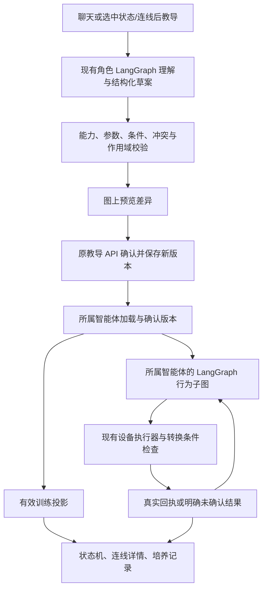

# 用户可训练的设备状态机设计

日期：2026-11-07。状态：待用户核对；本文和配套计划只定义工作，不表示功能已实现或已获准部署。

实施入口：[Implementation Plan](../plans/2026-11-07-trainable-device-state-machines.md)。

## 1. 用户目标与范围

用户通过自然语言持续培养设备：给已有状态转换增加条件、绑定触发事件、调整动作参数、组合行为流程；可以继续说“慢一点”“改成完成后再做”“取消刚才的条件”，系统修改同一份教导。状态机连线可以点击，清楚显示训练前后差异、当前生效内容、执行路径和训练来源。

以下约束来自本次讨论，优先于历史计划：

- 不新增感知能力，不新增运动能力；只编排已有状态机、观测、技能和参数。
- 语言理解、智能决策和行为流程继续使用现有 LangChain / LangGraph；不引入第二套 Agent 运行时。
- 训练覆盖转换条件、事件触发、动作参数与行为子流程，并包含跨设备组合。
- 前端连线可点击；训练痕迹必须可见、可解释、可修改、可撤销。
- 继续使用 React 18 无构建 PWA、同源 API/SSE、文件持久化和现有设备执行器。
- MQTT 继续承担控制面；灯通过 MQTT 执行，Go2 通过现有 HTTP/WebRTC 适配执行。
- 本次交付是设计和实施计划；不执行设备动作、不部署、不修改固件。

用户所说“走两步跑两步”表达可培养的行为节奏，不要求开发步数识别或新步态。解释时展示当前能力可执行的参数，不把“分段速度变化”宣称为新增跑步能力。

## 2. 产品定义

### 2.1 四种训练效果

| 效果 kind | 作用对象 | 含义 | 示例 |
|---|---|---|---|
| `guard` | 请求驱动的基础转换 | 增加必须满足的条件 | 有探索任务时暂不接受某个普通动作 |
| `trigger` | 已有转换 / 已保存流程 | 将结构化事件绑定到执行意图 | 灯熄灭时检测到声音，闪两次 |
| `preset` | 转换或命名流程中的动作 | 设置默认参数或明确的参数上限 | 提醒闪两次、指定 RGB/亮度 |
| `workflow` | 状态内部的行为子流程 | 顺序、分支、有界重复、等待、有限重试；不同设备可并行后汇合 | 探索移动后停下观察；狗完成招手后灯闪烁 |

`preset` 明确区分 `defaults` 与 `limits`：默认值可被当次明确参数覆盖；用户明确表达“最多/不得超过”的限制对所有普通入口生效。预设填充、限制检查和设备 schema 校验依次发生。不得静默截断用户显式参数。

### 2.2 三层视图

1. **基础设备状态**：来自现有 Go2State、动作目录、ESP32 ISM 与真实回执；用户训练不新增虚构姿态，不改写物理反馈。
2. **行为子流程**：例如“移动段 A → 观察 → 移动段 B”。节点代表云端行为阶段；用展开容器区分于身体状态。失败、等待、取消也属于运行阶段。
3. **训练覆盖**：条件、事件、参数和流程版本；由服务端投影到基础连线或行为子流程，不覆盖原始 Card 文件。

界面显示“正在尝试移动”不能替代 `body_state=moving`；只有真实反馈更新物理状态。

## 3. 当前代码证据

| 文件 | 已有基础 | 缺口 |
|---|---|---|
| `cloud/go2/state.py` | `LIFE_ACTION_SPECS` 同源生成条件说明及运行检查 | 用户定义条件、稳定 transition ID、请求上下文 |
| `cloud/go2/service.py` | `perform_life_control`、模式与用户接管 | 接入有效训练，避免被其他调用入口绕过 |
| `cloud/go2/tools/executor.py` | 共用动作/工具边界、租约、反馈 | 参数覆盖和训练条件的统一检查 |
| `edge/ism.py`、`cloud/cards/builder.py` | 灯物理表及 Card 生成 | 云端训练投影；本期不改物理表 |
| `cloud/esp32/tool_executor.py` | `execute_physical` 统一派发、账本、回执 | guard/preset、训练调用关联 |
| `cloud/agents/common/teachings.py` | API 单写、原子文件保存、分设备教导、revision | 强并发更新、版本历史、结构化训练及加载版本 |
| `cloud/agents/common/teaching_bindings.py` | 观测 → 技能验证 | 无状态条件、等待、流程、参数作用域 |
| `cloud/agents/steward/tools/__init__.py` | `save_rule` 待确认；Card 能力发现 | `_public_view` 未包含可训练拓扑；缺修改草案 |
| `cloud/agents/lamp/workflows/reactive.py`、`runtime.py` | 事件进入 Graph，manual/reactive、让位、同参冷却 | 有界重复与现有 300 秒冷却的作用域区分 |
| `cloud/go2/mode/free_explore.py` | 现有 frontier 导航、暂停/恢复、观察及结果 | 用户行为子流程接管点；休息挡自主事件不可用来承载唤醒限制 |
| `cloud/go2/navigation/navigator.py` | `go_to_coordinate(..., speed_limit=...)`、停稳确认、导航结果 | 在既有导航段边界传入训练参数；不新增路径规划算法 |
| `cloud/peers/policy.py` | 同伴与管家许可有差异 | 长期训练不能冒充永不过期的管理员会话 |
| `cloud/agents/common/checkpoint.py`、`effects.py` | FileCheckpointSaver、进程间运行锁、FileEffectLedger | 新训练子图复用它们，不能另建动作账本 |
| `app/src/pages/FsmGraph.jsx` | 节点已支持请求合法直接转换，连线只查看说明 | 保留节点控制，连线扩展训练详情 |
| `app/src/utils/stateMachine.js` | 层级投影、禁用原因 | 稳定 ID、训练覆盖与会话相关判断 |
| `app/src/app.jsx`、`RulesPage.jsx` | 教导确认及管理 | 图上差异预览、多轮修订、历史和运行解释 |

历史文档仅供背景；上述实现路径以本次工作区核对为准。

## 4. 架构与职责

训练归所属智能体。管家理解用户需求、生成提案、处理用户主动启动的跨设备流程；设备自己的自主教导由设备 Graph 接纳。管家不扫描所有设备教导充当常驻中央控制器。跨设备流程由一个明确的发起智能体持有 Graph，参与设备独立验证和执行。

新增 `cloud/agents/common/training/` 是现有 Agent 共用的领域契约、验证、投影与 LangGraph 子图装配代码。允许声明式有限流程编译为 `StateGraph`；禁止自写 `while current_node` 执行器、任意 Python/表达式执行或新的模型工具调用解析器。

## 5. 统一训练契约

### 5.1 稳定引用与能力声明

给基础转换增加显式 `id`。例如 Go2 `activity.rest.wake.active`；灯 `lighting.OFF.CMD_BLINK.BLINKING`。源状态、触发和目标相同但语义不同的边必须用声明中的独立 ID。不能使用数组索引或中文标签作为持久引用。

Card 增加 `training_capabilities`：版本、可训练转换引用、允许事件及字段、参数 schema 引用、可组合原子步骤、完成依据与支持的编排节点类型。保持 retained Card 为能力声明；用户原话、历史和逐用户判断不写入 retained Card。

兼容旧 Card：基础控制保持；没有稳定可训练声明时隐藏“确认并生效”，允许保留未绑定教导。Card hash 只覆盖训练相关稳定字段，不包含 online/state、布局、易变描述文字。

### 5.2 记录结构

沿用 `teaching_id / unit_id / space_id / name / source_text / revision`；v2 增加 `definition`、`capability_hashes`（按参与设备 ID 映射）、`desired_status`、`activation`、`grants`、`history`。grants 由服务端从确认定义生成，模型不可写。每个修订保存不可变定义、原话和结构化差异；当前指针和历史在同一个原子分区写入中更新，避免双文件部分提交。

`definition` 字段：

| 字段 | 类型与约束 |
|---|---|
| `kind` | `guard / trigger / preset / workflow` |
| `target` | `{unit_id, region_id, state_id?, transition_id?, workflow_id?, step_id?}`；必须属于当前 Card 或当前训练 |
| `scope` | `{origins: [user_delegated, agent_autonomous], modes: [...], activity_required: bool}`；来源由可信上下文提供 |
| `condition` | 有限条件树，见下文；无条件为 `null` |
| `event` | `{id, where, max_age_s, cooldown_s}` 或 `null`；只使用声明事件 |
| `defaults` | 参数对象，未明确指定的参数才填充 |
| `limits` | 参数允许区间/集合；不能放宽设备原范围 |
| `workflow` | `{entry, nodes, edges, max_steps, max_duration_s}` 或 `null` |

所有字段都显式提供；根据 kind 检查无关字段为空。初始产品上限：32 个流程节点、嵌套 3 层、每次重复至多 20 次、单次运行最多 100 个逻辑步骤 / 600 秒；更短的设备/会话时限优先。超过上限的教导展示限制并要求缩短，不静默裁切。“持续探索”由既有探索生命周期反复接纳有界行为段，计数跨段保存，停止探索立即终止，不创建无限 Graph 调用。

### 5.3 条件和输入事实

条件语法仅允许 `all / any / not` 和 `{fact, op, value}`；op 为 `eq / ne / in / lt / lte / gt / gte`。事实来自 Card 声明的状态、结构化事件、已完成步骤结果、训练计数/冷却和可信调用来源。缺失、过期、类型不匹配为 `unknown`，不得通过否定把 unknown 变为允许。只有完整条件为 true 才放行。

基础条件 AND 所有适用的训练 guard；普通训练不能改变连接反馈、动作完成、闪烁恢复、急停和故障处理等系统转换。`defaults` 冲突、区间交集为空、同一作用域多个入口流程竞争都在预览时返回可定位的冲突，不使用最后写入覆盖规则。有限条件域做静态交集检查；无法判定互斥时提示冲突并要求明确作用域，不能让运行时模型悄悄选择。

事实必须带来源、时间、设备 epoch/revision（如有）。跨设备事实新鲜度逐项检查。视觉自由文本不能直接成为“看见同一个人”等硬条件；模型可在既有 Graph 内从经过校验的有限候选行为中选择，但必须记录所用事实和选择理由。

### 5.4 流程节点

| 节点 type | 含义与执行规则 |
|---|---|
| `skill` | 一个已有技能调用；记录稳定 step/request ID，必须核对实际完成依据 |
| `branch` | 对结构化条件选择边；unknown 走明确的等待/结束分支 |
| `repeat` | 有限次数和退出条件；迭代号参与副作用 ID |
| `wait` | 等待结构化事件或期限；Graph interrupt，事件/计时适配恢复 |
| `decision` | 现有角色模型在声明候选步骤间选择；结构化输出，不能生成未确认的新技能 |
| `parallel` | 最多两个分支，仅不同设备；全部成功后汇合，同设备写动作禁止并发 |
| `finish` | 结束、取消、失败或请求用户帮助，明确终态 |

不允许任意环；重复只能用 repeat 节点。失败重试作为有界分支编排，仅在已经确认本次动作失败且当前可执行时发起新 ID。timeout/unknown 不当作失败可重发，而是查询原请求或结束为未确认。恢复先前状态也必须是合法新请求；取消、接管、状态不再允许时不执行“恢复”。

### 5.5 版本与生效

区分 `desired_status=enabled/disabled` 与 `activation.status=pending/active/paused/error`。`pending` 表示保存成功但所属智能体尚未加载。`active` 只表示版本已加载，实际是否可执行另列 mode、连接、让位、事实等条件。

API 是教导唯一写入口；所属智能体通过服务认证确认 `{teaching_id, revision, capability_hash}`。执行前重新核对当前有效 revision。跨设备流程每个参与者确认能力和执行许可后才激活；失败显示具体设备原因，不显示部分流程已全部生效。

编辑/禁用/撤销时，先禁止旧版本派发新步骤，标记旧运行取消；仅停止它仍拥有的设备任务，不取消后来由用户启动的任务。新版本对新运行生效；不把运行中的节点参数热替换。迟到结果只完善旧运行证据，不触发下一步。恢复历史内容创建新 revision，不能倒退版本号。

撤销与派发以受锁保护的预登记为先后界线：撤销提交后不能产生新的旧版本预登记；此前已预登记的动作按在途处理，查询/取消并等待证据。页面显示“正在取消”直到在途任务结果明确，不能把配置停用等同物理动作已经停止。

### 5.6 参数与入口一致性

执行流程：归属/会话检查 → 原请求 ID 去重 → 读取生效训练 → 解析实际转换 → 显式参数与 defaults 合并 → limits/schema → 基础条件与训练 guard → 在现有执行锁内核对 revision/状态 → 预登记 → 派发 → 真实结果。

作用于基础转换的 guard/limits 对聊天、按钮、管家、同伴、自主路径一致；流程内的预设只影响对应 step。按钮不得自动发送 Card 中所有默认参数，否则“未显式输入”会被误判为用户覆盖教导；API 同时保留原请求参数和实际派发参数指纹，复用现有幂等账本。

灯条件在云端统一执行边界生效，边缘 ISM 继续拥有物理事实最终权威。本期不下发规则，不承诺绕过云端直接向 broker 发命令仍受训练约束。

## 6. 运行、事件与跨设备授权

### 6.1 LangGraph

子流程使用 `StateGraph` 与现有 `FileCheckpointSaver / FileEffectLedger`。每次训练运行有独立 thread ID、run ID、教学 revision、设备 epoch、当前步骤、迭代计数、等待条件和取消状态；不复用用户聊天 thread。

`interrupt()` 会在恢复时重入节点，因此等待节点只注册幂等 wait 信息并暂停；不能在 interrupt 前重复派发硬件动作。等待通过已有服务事件入口和 `asyncio.call_later`/灯事件队列投递匹配结果，以 `Command(resume=...)` 恢复。计时器只负责投递期限事件，没有决策逻辑。持久等待位于 Graph checkpoint；重启只重建未来计时器、核对旧任务，过期运动流程进入待确认/取消，不补跑。

实现依据：[LangGraph Interrupts](https://docs.langchain.com/oss/python/langgraph/interrupts)、[Persistence](https://docs.langchain.com/oss/python/langgraph/persistence)、[Graph API](https://docs.langchain.com/oss/python/langgraph/graph-api)。以项目锁定版本实际 API 为准，不引入文档中依赖额外托管服务的功能。

### 6.2 事件契约

新增的是现有事实的标准化适配，不是新感知：`sensor.sound_detected`、`sensor.light_changed`、已有 `vision.person_presence`、导航结果、动作完成、训练计时和 PWA 明确回应。事件包含 `event_id / source_unit_id / kind / ts / epoch / request_id / run_id / step_id / values`，不适用字段为 null。

只有同一运行关联的真实完成结果推进依赖步骤；普通“狗刚才打了招呼”的聊天文本不能当完成事件。事件入队去重、执行前校验期限、运行锁串行恢复、持久化已消费 ID，覆盖 MQTT QoS1、SSE 重连和并发计时竞争。只读 UI 不通过轮询驱动流程。

### 6.3 跨设备的训练许可

现有 `permits_skill` 对自主 blink、部分运动和 life 存在限制。保留普通请求许可；新增**经用户确认的训练步骤许可**作为受限分支，不能把自主上下文改成 admin 或重用旧用户会话。

许可由 API 随确认生成，绑定当前空间、teaching ID/revision、发起设备、目标设备、step ID、固定参数或明确范围；目标从服务端存储加载并验证，传输只带经现有签名/内部认证保护的运行引用。许可仅允许当前已声明、可组合且用户可授权的技能，不覆盖模式、租约、真实状态、急停或保密数据读取权限。撤销立即使未派发步骤失效。

同一设备同一时刻只有一个物理控制所有者；跨设备不持有全部设备锁等待，按步骤申请并及时释放，避免互等。parallel 分支失败时取消本流程仍拥有的其他分支，结果显示可能已发生的部分效果，不宣称自动回滚物理世界。

## 7. 现有能力内的六组验收案例

| ID | 教导及后续修改 | 使用已有能力的版本 | 图上验收 |
|---|---|---|---|
| A | “探索看到人先打招呼再继续”；“一分钟内别重复” | 使用已有人出现事件；停稳后 Hello，恢复前重新检查探索许可；冷却基于时间，不实现同一个人识别 | 探索内插入停稳/招手阶段，边上显示冷却 |
| B | “探索一段慢一点，下一段快一点，中间观察”；“观察久一点” | 使用已有 frontier 导航段、speed_limit、observe；快慢都在既有范围，无新跑步/计步 | 探索子图、速度上限和等待时长前后变化 |
| C | “提醒先闪一次，没回应再闪两次，最多三轮”；“我点知道了就停” | 灯 BLINK + PWA 回应 + 软件期限事件；不新增手势/语音识别 | 有界重复、等待/超时分支、原状态恢复与中断 |
| D | “狗招手完成后，灯闪一次”；“改成灯结束后狗再招手” | Hello 和 BLINK 的真实完成回执，保持现有前置姿态约束 | 两设备关联边顺序改变，未确认不推进 |
| E | “探索受阻最多换两次现有候选目标，还是不行就问我” | 既有 frontier 候选、navigator 失败原因；身体净空不足不盲目重试，unknown 不重发 | 失败分支、重试计数和等待用户阶段 |
| F | “把招手和闪灯叫作庆祝”；“一起开始，最后都完成才结束”；“改为先后执行” | 两个现有设备动作、跨设备 parallel/join 与 sequence；不保证物理同时开始 | 命名流程、并行/顺序结构变化及真实分支结果 |

所有案例都要能：理解 → 预览 → 确认 → 生效版本 → 执行证据 → 多轮修改 → 撤销。A/B/E 使用现有感知/导航不可用时显示暂停；软件模拟验证流程语义，真机反馈另行记录。案例不是功能白名单，新设备通过契约声明同样使用通用训练；设备适配只包装已存在的能力。

## 8. 前端体验

### 8.1 连线详情与教学入口

点击状态节点（或键盘 Enter）请求进入该状态：存在唯一可用直接转换时执行；条件不满足时解释原因；多条转换可用时由用户选择，不自动规划多步路径。点击当前状态只查看说明。当前高亮只随真实反馈更新。点击连线（或键盘 Enter）打开详情，不执行动作。详情有触发事件、条件列表、参数、原话来源、当前版本、当前可用原因；节点控制是主要执行入口，详情可提供参数调整及辅助“执行一次”按钮。安全停止继续保留直接入口。边不可用也能查看和教导；离线可保存，标明等待加载/当前不可执行。

详情底部支持“教它改变这一步”，将 selection `{unit_id, region_id, transition_id, teaching_id?, revision?}` 传给现有聊天 Graph。服务端验证 selection 归属；选中上下文帮助理解，不授予执行权限。设备页和主聊天共用训练草案契约，无第二个模型接口。

### 8.2 可见训练痕迹

边上默认最多一个摘要徽标：“你教的 · 2 条条件”“已调整 · 闪烁 2 次”；颜色只是辅助，文字/图标共同表达。点击展开训练来源与参数。隐藏的颜色自循环通过动作详情可访问，训练后可显示轻量标记；不强迫所有自循环占据主图。

预览显示新增/修改/删除、受影响的边、原值→新值。保存后先显示“已保存，等待加载”，加载确认后显示“已生效”；运行中的等待、模式未开启、让位分别解释。保留未确认草案，刷新后从 API 恢复。

复杂行为在状态内部可展开；物理状态用实线与真实当前态，行为阶段用独立容器及阶段标签。跨设备图只投影涉及的状态与步骤，不复制两个完整白板。

### 8.3 培养记录与多轮修改

设备页展示每条教导原话、当前可读规则、版本差异、最近一次应用结果；支持暂停、修改、撤销、恢复历史版本。状态机连线和记录双向定位。保留 RulesPage 为统一管理入口，底层仍是一份教导存储。

“刚才那个快一点”若只有一个明确选中步骤可直接生成修改草案；多个匹配时让用户选择具体步骤，保留已理解内容。普通临时命令与长期教学明确分开，不把每次参数命令自动写成习惯。

### 8.4 移动端与即时反馈

窄屏使用底部详情面板，触控目标至少 44px；面板打开时保持画布视角，关闭恢复焦点。避免点击与拖动画布冲突。满足键盘操作、非颜色提示、减少动态效果偏好。草案生成显示真实阶段；模型耗时长时有进度和取消，不用假动画冒充保存完成。

## 9. 验收与不在范围内的工作

完成标准：六组案例在模拟环境跑通，基础条件/参数覆盖所有入口，运行不重复派发，训练修改与撤销立即阻止旧后续步骤，手机和桌面可定位训练痕迹；现有设备操作、人格、manual/reactive、探索、真实回执、急停和会话隔离回归通过。

软件验收不等同真机验收；真机在设备就绪时按案例记录实际证据。文档中不预填通过结果。

不开发新检测器、身份/声纹/步数识别、新运动动作、导航算法、新固件规则下发、任意代码执行、第三方工作流平台、长期数据库或训练积分等级。故障恢复不自动重放运动。当前架构要求共享持久化目录；跨主机部署另行处理，不用本期假定解决。
