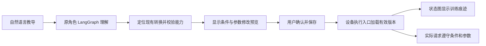

# 用户可训练的设备状态机设计

日期：2026-11-07。状态：按最新讨论收敛为首版，待核对；不表示训练功能已实现。

实施入口：[Implementation Plan](../plans/2026-11-07-trainable-device-state-machines.md)。本版替代此前以多步流程、跨设备编排为主要交付的设计。

## 1. 产品目标

用户通过自然语言调整**已有状态机的转换条件、触发方式和动作参数**，使设备形成用户培养出来的习惯。智能性体现为理解含糊表达、定位已有状态/转换、生成可解释的修改、理解后续追改；可编排性体现为条件与参数组合后真实影响设备行为。

**两项不可替代的产品验收：**

1. **智能性可编排，并通过状态机改变行为。** 用户教“看到人就打招呼”，已有站立→打招呼转换增加事件触发；教“休息时只有主人能叫醒”，已有休息→待命转换增加准入条件。执行入口必须遵守，不能只存一句记忆或只画一个标记。
2. **编排以用户自然语言为中心，修改可感知。** 用户不需要找字段或手工连线；系统理解并定位受影响的边，预览后确认。连线上有训练标记，点击能读到自己设置的条件、原话和当前是否满足，并可继续对话修改、暂停或撤销。

触发条件回答“什么事件会发起转换”，准入条件回答“发起后必须满足什么才允许转换”。UI 用自然语言分别标为“触发条件”和“允许条件”：不能把“看到人就招手”误解为所有手动招手也必须看到人，也不能把“只有主人才能叫醒”降成一个可被其他入口绕过的提示。

首版不让用户创建新状态、绘制任意流程或编写规则表达式。设备原本就有的动作、状态和执行流程继续存在；教学改变它们什么时候可以发生、如何触发以及使用什么参数。

### Global Constraints

- 不新增感知能力或运动能力，只使用已声明并实际接入的设备状态、事件和动作。
- 自然语言理解继续走现有 LangChain / LangGraph；不新增 Agent 循环或通用工作流运行时。
- 首版只做单设备已有转换的条件、参数和单事件触发；不做跨设备流程、新状态或任意多步编排。
- 点击可执行状态节点请求合法转换；点击连线查看条件、参数和训练痕迹，不触发动作。
- 设备当前物理状态只由真实反馈更新；保存、请求已接受、实际完成分别展示。
- 条件对适用范围内的按钮、聊天、管家、同伴和自主入口一致；训练不能放宽基础设备约束。
- 保留 MQTT 控制面、既有 MQTT/HTTP 执行通道、真实回执、用户让位和急停。
- 旧教学链路可以替换删除，不保留旧 binding/API 兼容要求；旧数据归档，不自动迁移或启用。
- 保留 React 18 无构建 PWA；首版复用当前设备页、状态机白板和聊天。
- 本次交付仅更新文档；实施先用隔离存储和模拟传输验证，不部署、不操作真机或生产教导数据。

## 2. 从简单到复杂

| 阶段 | 范围 | 是否本次执行 |
|---|---|---|
| P1a | 自然语言修改已有边的条件和参数，图上预览/确认，所有入口执行一致 | 是，先形成闭环 |
| P1b | 首先跑通看到人→站立到打招呼，再以灯声音事件验证同一契约 | 是，P1a 验收后继续 |
| P2 | 调整既有探索过程的阶段条件、停留时长和导航参数 | 否，仅保留下一阶段方向 |
| P3 | 利用已有地图事实按环境选择参数，例如空旷快、拥挤慢 | 否，先定义可靠事实和验收 |
| P4 | 用户定义多步行为、跨设备顺序/并行 | 否，首版不建设相关基础设施 |

下一阶段不能被实施者顺手纳入首版。首先证明一条边被教导后，页面解释与真实派发结果一致。

## 3. 首版验收场景

### A. 核心示例：看到人就打招呼

用户：“看到人就打招呼。”

定位已有 `standing → greeting` 的 Hello 转换，绑定已有人出现观察 `vision.person_presence`、detected=true。图上显示“看到人 · 你教的”，点击连线可见触发条件、适用源状态、动作、原话和生效状态。只有机器狗处于允许的自主模式、真实站立、事件有效且满足原条件时发起 Hello；躺着或休息时不自动起身、不排队补招手。手动招手仍按原普通条件执行。

在现有检测结果上把“没人→有人”作为出现事件，同一段持续有人不因每帧检测重复触发；未知/过期帧不能当成离开后又出现。这是软件事件适配，不新增检测或身份能力。若暂时没有新鲜的人物事件，页面显示未满足触发条件，不能假装训练已执行。

后续：“招呼完一分钟内别再自动招呼。”“改成半分钟。”修改同一条事件教导的 cooldown，默认仅限制这条自动触发，不能默默限制手动请求。若用户另说“任何时候招手都要间隔一分钟”，才生成覆盖所有普通来源的无 trigger 准入教导。

冷却从受约束动作的真实完成开始，accepted/timeout 不算完成；结束冷却不自动招手，仍需新的有效触发。修改和撤销必须在同一连线详情中可见。

### B. 调整灯的提醒方式

用户：“以后闪烁提醒默认闪两次。”

把已支持的 BLINK 请求转换作为目标组，修改默认 `count=2`。默认仅填充未明确指定的参数；“这次闪五次”仍用 5（设备允许时），不是永久修改。前端按钮不能把 Card 默认值当作用户显式输入发送。固定命令标识如 SET_STATE 的 state 仍由目标转换提供，不能省略。

后续：“改成三次。”修改原教导而非新建竞争规则。确认卡列出实际受影响的边；不修改 BLINK_DONE 等设备自动完成转换。

### C. “关灯时轻轻提醒我”的组合场景

用户：“灯关着的时候，听到声音就闪两次，别连续闪个不停。”

作用于已有 `OFF → BLINKING`，绑定现有 `sensor.sound_detected` 事件，设置 count=2，并针对“别连续”提出明确冷却时长供确认，例如 20 秒。事件来源为灯已接入的声音传感器。常亮状态不匹配此教导，冷却期间不重复触发。原 reactive 模式和用户让位仍有效；没有运行条件时说明原因，不自行打开自主模式。

“闪两次”作为这条事件教导的参数设定，只影响该事件请求；不能默默改变用户手动闪烁的次数。更一般的默认值修改仍由场景 B 表达。

用户：“隔久一点再提醒。”“只改成闪一次。”只修改对应字段。对声音事件去重；模式关闭、让位、冷却或事件过期时丢弃此次触发，不排队等到未来突然补闪。

此场景是**一条事件 → 一条现有转换**，不是新的流程编排。闪烁完成后的状态恢复由原固件规则决定。

### D. 准入条件示例：只有主人才能叫醒

用户：“休息的时候，只有主人才能叫醒你。”

定位休息→待命的普通 wake 转换，增加可信 `requester_is_owner == true` 条件。连线显示“仅主人可唤醒 · 你教的”，点开显示原话、允许条件、身份是否已确认。任何普通调用来源都必须提供可验证的请求者事实；不能通过按钮、管家代转或自主事件绕过。

本例不要求新增身份感知。逻辑和页面用主人/非主人/未知三组可信模拟事实验收；真实启用仅在现有调用身份或已接入身份能力足以确认该请求发起者时开放。单纯在画面中看到了主人、actor=admin、模型声称“这是主人”都不能证明当前唤醒请求来自主人。能力缺失时保留待确认草案并明确原因；已生效后事实暂时未知则不放行。急停、断连和设备故障恢复等系统转换不受教学限制。

## 4. 首版交互

教学入口沿用主聊天和设备聊天。选中连线后可以说“给这一步加个条件”，selection 作为经过服务端验证的上下文传入原角色 Graph。流程为：



- **修改卡**：例如“站立 → 招手；新增触发条件：看到人”或“休息 → 待命；新增允许条件：请求者是主人”。含确认、取消和定位连线。
- **连线标记**：默认最多一枚摘要，如“你教的 · 看到人”“你教的 · 仅主人可唤醒”“已调整 · 闪烁 2 次”。展开显示基础条件、用户条件、参数、原话、版本和当前阻止原因。
- **参数归属**：首版参数绑定到实际转换动作；若节点汇总展示参数，必须能定位回对应边，不能让动作参数与节点说明各存一份。
- **培养记录**：一个共用抽屉即可，列原话、当前效果、最近应用结果，支持定位、暂停、修改、撤销；先不做独立复杂历史页面、行为子图编辑器或培养积分。
- **状态文案**：“待确认”“已保存，等待加载”“已加载”“已暂停”；已加载不等于设备当前可执行，模式/在线/冷却原因单独显示。
- 点击状态节点仍请求动作；条件不满足时显示原因，不通过点击排队等候、不自动规划绕过条件的路径。

没有能力时指出缺少哪项，只保留待修改草案，不能说“已学会”。时间和次数建议必须在确认前展示；目标唯一时少追问，多目标歧义时让用户选择。临时动作与长期教导必须分流。

## 5. 最小数据契约

### 5.1 能力目录

基础转换增加稳定 ID，不能用数组索引或中文标签持久引用。Card 的 `training_capabilities` 只列已接入的目标边、允许条件、参数字段和事件；教学不修改 retained 基础 Card，不把用户原话发布到控制面。

首版条件仅支持：

- 当前设备已有状态字段和已接入的可信请求上下文字段的 `eq / in`；多个条件为 AND，不提供任意布尔表达式。请求者字段只能由服务端身份链路提供，不能从模型文本获取。
- `cooldown_s`：距该转换上一次确认完成的间隔；基准和适用来源在预览中说明。
- 事件字段等值过滤；仅在有 trigger 的教导中使用。

条件字段、时长范围和参数范围来自明确声明；未知/过期状态不放行。自动反馈、断连处理、急停和故障转换不可训练。更复杂条件以后按实际需求扩展。

### 5.2 记录和定义

新存储位于 `SSM_TRAINING_DIR`，默认 `cloud/agents/data/training`；不读取旧 `SSM_TEACHINGS_DIR`。

```text
记录：schema_version=1, teaching_id, unit_id, space_id, name,
      source_text, revision, definition, desired_status,
      capability_hash, loaded_revision, history, created_at, updated_at
定义：transition_ids, origins, conditions, cooldown_s,
      defaults, trigger
trigger：null 或 {event_id, where, params}
```

一条记录仅属一个设备，可覆盖同一动作的一组已有转换。conditions 是 `{field,op,value}` 列表；defaults 是未显式指定时填入的参数。trigger.params 是该事件生成的具体动作请求参数。带 trigger 的记录仅对该事件触发请求施加自身条件、冷却和参数；无 trigger 的记录对 origins 声明的全部普通请求生效。受信事件上下文由服务端生成，客户端不能伪造以扩大适用范围。

同一作用域的默认参数存在不同值、或同一事件/目标存在重叠的竞争教导时，首版拒绝保存并要求修改原教导，不建立优先级引擎。不同普通 guard 可同时生效，条件取交集；事件请求还必须遵守适用于普通自主来源的 guard。

首版不引入 workflow/step/grant DSL、参数限制语言、任意脚本或自动迁移。所需权限复用现有可信上下文，仅对经确认的单设备事件触发增加精确授权校验，不建设跨设备许可体系。

### 5.3 确认、生效和撤销

只有 API 可写配置，模型工具只能提出草案。确认携带 base_revision 和能力 hash，幂等写入；版本冲突返回 409。修订保留原话及旧定义，UI 先提供撤销/暂停和最近修改，完整历史恢复界面不作为首版要求。

执行进程确认加载当前 revision 后才显示已加载；每次派发前在执行锁内复核定义和版本。撤销立即阻止新的旧版本派发，已发送动作按原回执流程核对，不声称“撤销教导”就已经停止硬件动作。用户急停仍直接可用。

## 6. 最小执行链路

1. 普通请求仍进入原设备执行器；单事件触发进入所属设备的原 LangGraph，最多提出一个绑定动作请求。
2. 从当前真实状态解析已有转换，读取适用的已确认训练。
3. 保留用户显式参数，填入 defaults；事件请求从 trigger.params 生成，再执行同样的参数校验。
4. 检查原权限/模式/让位/基础转换条件和训练条件；冷却计算使用确认完成记录，不使用模型回复。
5. 在原执行锁和幂等账本边界内复核版本、预登记并派发；真实结果更新原账本及训练解释投影。
6. 状态图只展示这份定义和真实执行证据，不单独维护 UI 规则。

训练是原执行器的配置和检查，不是第二个调度器。冷却和完成事实从现有结果账本/回执投影取得；允许建立可重建的查询索引，不能新建另一套动作成功真相。进程重启不能清零有效冷却，未确认动作仍按原规则处理。

灯的普通自主判断继续由原 Graph 负责。教学触发进入同一运行/设备执行边界；避免同一事件一边执行绑定动作，一边另起普通调光。模型可以基于当前约束不执行，但必须给出原因，不能把绑定的“闪两次”悄悄改成别的动作。

## 7. 复用与删除

保留三角色 Graph、会话权限、设备 FSM、导航、感知、人格、空间要求、执行器、账本、SSE 和当前节点控制。借鉴旧链路能力校验、确认后保存、原话溯源和原子写入的做法。

用新教学工具/存储/API 替换旧 save_rule、pending_rule、binding CRUD、teachings.py、teaching_bindings.py、旧确认卡和 RulesPage/RulesDrawer。删除灯 teaching_candidates 和 Go2 特定 Hello 教导消费分支，保留其观测来源和普通自主行为。所有读取入口改接新培养记录，不保留旧运行备用分支。

旧数据只读归档并保留原文件；新训练从空集开始。新旧消费者不并行上线。首版不建复杂迁移工具、永久兼容层或新旧运行版本选择器。发布是后续独立动作，当前计划只完成代码与模拟验收。

## 8. 下一阶段边界

“观察时间长一点”属于 P2：当前探索由 `cloud/agents/go2/workflows/search.py` 的既有 observe/select/navigate 阶段实现，必须在实际阶段上开放最短观察停留参数，保持有效观察及导航回执条件；不能只改外层 free_explore.py，也不能只加 sleep 后宣称观察成功。

“空旷快、拥挤慢”属于 P3：现有地图与 navigator.speed_limit 提供基础，但需明确路径前方已测通行空间的统计、未知处理及调速边界。不能把原地转身净空或未知区域直接当作前方空旷。当前首版不承诺实现。

跨设备接力、并行、用户定义循环、等待用户回应、多步失败恢复属于 P4。首版不为这些功能提前建设编译器、事件恢复运行时或通用子流程 UI。

## 9. 完成标准

A 为首要触发验收，D 为准入条件逻辑/页面验收（身份能力边界见 §3）；B/C 验证参数及设备间契约复用。各场景均能从一句话得到可理解的修改预览，确认后图上有痕迹，实际请求受约束；至少一次多轮追改、暂停/撤销可验证。各普通控制入口结果一致，重复请求不重复派发，重启后教导和冷却仍有效，旧数据不会被新系统自动执行。

软件测试使用模拟模型/设备及临时目录；真机与语言模型质量验证分别记录，不预填通过结果。首版验收不包含 P2–P4。
